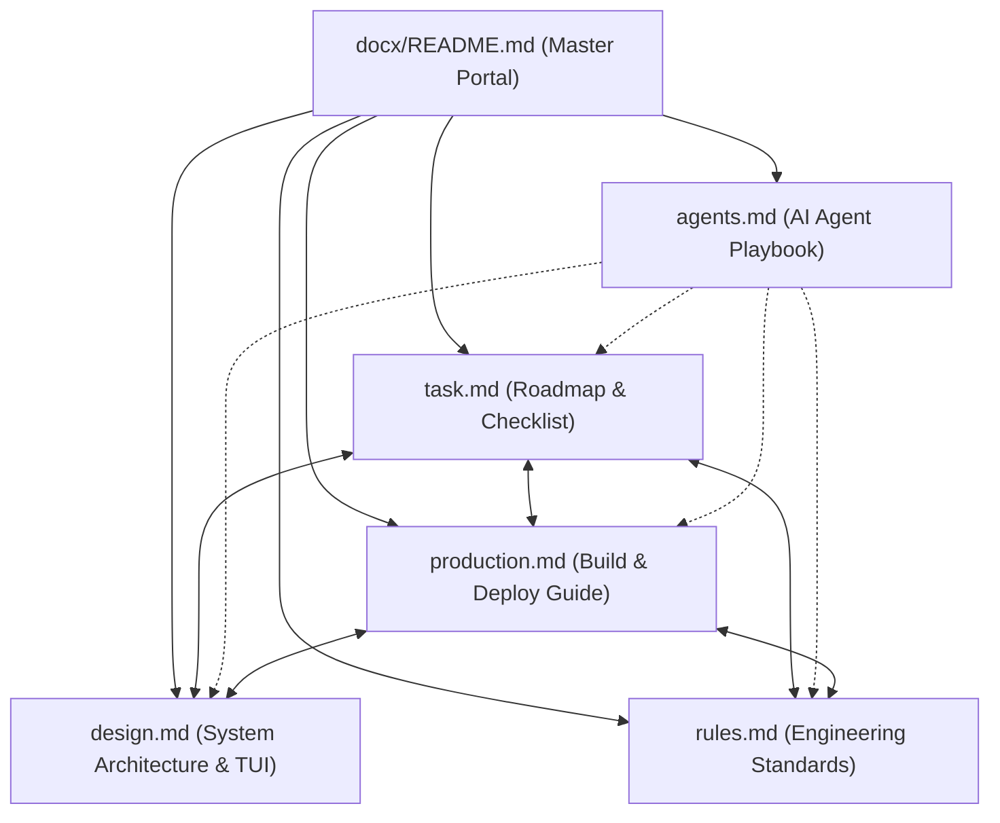

# Raptech Autotrade CLI — Dokumentasi Utama & Panduan Sistem

Selamat datang di pusat dokumentasi resmi **Raptech Autotrade CLI** (Terminal UI & Headless Edition). Repositori ini berisi rancangan arsitektur, panduan rekayasa perangkat lunak, standar keselamatan modal, panduan rilis produksi, dan roadmap kerja untuk bot otomatisasi trading MetaTrader 5 (MT5).

### 💻 Stack Teknologi Antarmuka Terminal:
Aplikasi mengombinasikan dua pustaka UI terminal modern:
- **Rich Python** (`pip install rich`): Mesin visual, warna TrueColor, markup format, tabel Unicode, dan status bar telemetry live.
- **Textual** (`pip install textual`): Framework aplikasi Terminal UI Interaktif layar penuh berbasis `asyncio`.
- **Typer** (`pip install typer`): Framework CLI dispatcher subcommands mandiri yang elegan.

```bash
pip install rich textual typer MetaTrader5
```

---

## 📌 Indeks Navigasi Cepat (Quick Navigation)

| Dokumen | Deskripsi Singkat | Target Pembaca |
|---|---|---|
| [📋 **task.md**](task.md) | **Roadmap & Checklist Pekerjaan**: 9 fase pengembangan terstruktur, mulai dari scaffolding, trading engine, risk manager, multi-profile, TUI, skrip strategi, hingga build produksi. | Developer, Project Lead, AI Agent |
| [📐 **design.md**](design.md) | **Arsitektur & Desain Sistem**: Diagram alur (Mermaid), mockup Terminal UI (Unicode Symbols & Rich), subsistem multi-profil, konektivitas ganda Native MT5 & MCP, skema warna, dan spesifikasi CLI. | Software Architect, UI/UX, Developer |
| [🛡️ **rules.md**](rules.md) | **Standar Rekayasa & Pantangan Ketat**: Aturan perlindungan modal (Stop Loss wajib, limit volume, circuit breaker), thread-safety MT5, isolasi async event loop, dan nol dependensi GUI Qt. | Seluruh Kontributor & AI Agent |
| [🚀 **production.md**](production.md) | **Panduan Build & Deploy Produksi**: Konfigurasi PyInstaller slim spec (~28-38 MB), panduan deploy VPS Linux/Windows, Windows Service (NSSM), dan pemecahan masalah operasional. | Release Engineer, DevOps, Operator |
| [🤖 **agents.md**](agents.md) | **AI Agent Playbook**: Panduan operasional dan *thinking model* khusus untuk AI Coding Assistants (Antigravity, Cursor, Claude Code, Trae, dll), checklist verifikasi, dan pantangan library Qt. | AI Assistants & Pair Programmers |

---

## 🗺️ Peta Relasi Antar Dokumen (Documentation Graph)



---

## ⚡ Ringkasan Fitur Inti & Bab Penting

1. **Terminal UI & Visual STATUS**:
   - Preview Terminal UI (Unicode): [design.md §4.1](design.md#41-ultra-light-tui-wireframe-mode-live)
   - Matriks Status CLI & Warna: [design.md §4.2](design.md#42-matriks-status--indikator-warna)
   - Sinergi Rich + Textual: [design.md §2](design.md#2-sinergi-antarmuka-terminal-rich--textual)
2. **Konektivitas Pasar & Thread-Safety**:
   - Dual-Backend Native MT5 & Remote MCP: [design.md §3](design.md#3-dual-backend-connectivity--thread-safety)
   - Aturan Dedicated Worker Thread: [rules.md §2](rules.md#2-aturan-thread-safety--konektivitas-metatrader-5)
3. **Proteksi Risiko & Keselamatan Modal**:
   - Virtual Stop Loss, Take Profit & Trailing Stop: [design.md §6](design.md#6-manajemen-risiko--proteksi-virtual-sltp)
   - Invariant Modal & Circuit Breaker: [rules.md §1](rules.md#1-aturan-keamanan-modal--finansial-capital-protection-invariants)
4. **Verifikasi & Build Produksi**:
   - Verification Checklist: [agents.md §4](agents.md#4-alur-verifikasi-pekerjaan-verification-checklist)
   - Slim PyInstaller Spec: [production.md §3](production.md#3-konfigurasi-pyinstaller-slim-spec)
   - Pipeline Eksekusi Build: [production.md §4](production.md#4-pipeline-build-otomatis)
