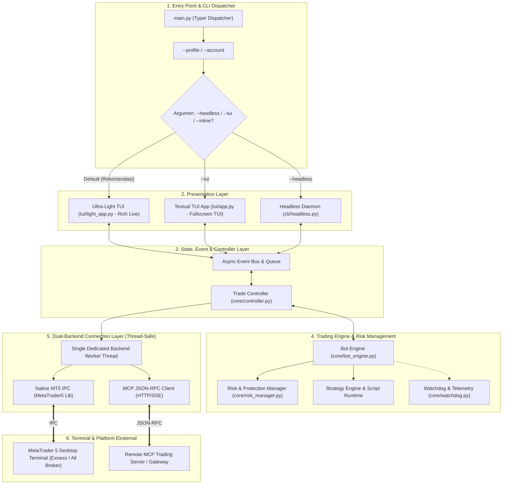
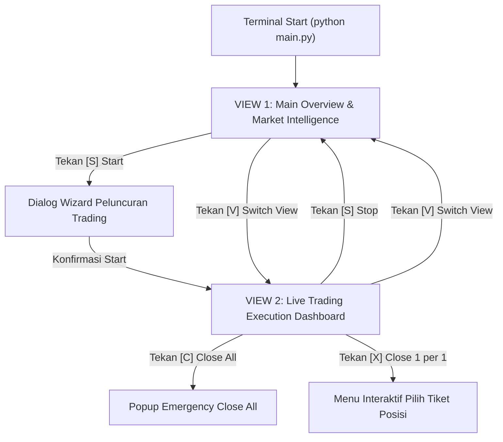

# Architecture & System Design — Raptech Autotrade CLI

> 📌 **Navigasi Dokumentasi**:  
> [📋 Task & Roadmap](task.md) • [📐 System Design](design.md) • [🛡️ Engineering Rules](rules.md) • [🚀 Production Guide](production.md) • [🤖 Agents Playbook](agents.md)

Dokumen ini memuat cetak biru (*blueprint*) arsitektur perangkat lunak, perancangan antarmuka terminal interaktif (**Textual TUI** & **Ultra-Light Rich Live**), subsistem konektivitas ganda (*Dual-Backend Native MT5 & MCP*), penanganan thread-safety, manajemen risiko trading presisi, dan antarmuka CLI Typer untuk **Raptech Autotrade CLI**.

---

## 1. Arsitektur Tingkat Tinggi (High-Level Architecture)

Aplikasi dibangun menggunakan pola arsitektur berlapis (*layered modular architecture*) yang memisahkan antarmuka terminal dari mesin eksekusi order MetaTrader 5.



---

## 2. Sinergi Antarmuka Terminal: Rich + Textual

Mengikuti standar antarmuka modern seperti pada *Autoclaim*:
1. **Ultra-Light TUI (`tui/light_app.py`) [DEFAULT]**:
   - Bertenaga **Rich Live** murni (< 30 MB RAM, < 1% CPU).
   - Menampilkan status bar telemetri, ringkasan saldo akun, tabel open positions berformat badge Unicode, grafik mini sparkline, serta live streaming log aktivitas.
   - Responsif tanpa lagging di Windows Console / PowerShell / CMD / PuTTY / SSH VPS.
2. **Interactive Textual TUI (`tui/app.py`) [OPSIONAL `--tui`]**:
   - Tampilan layar penuh interaktif berbasis widget tree `textual`.
   - Terdiri dari 5 Tab: **Dashboard**, **Positions**, **Manual Trade**, **Strategy Manager**, dan **Live Logs**.
   - Dilengkapi dialog modal untuk ganti profil, konfigurasi risiko, dan emergency close.
3. **Headless Runner (`cli/headless.py`) [`--headless`]**:
   - Berjalan sebagai background daemon tanpa render loop terminal.
   - Cocok untuk server Linux / Windows VPS via `tmux` atau Windows Service.

---

## 3. Dual-Backend Connectivity & Thread-Safety

### 3.1 Masalah Thread-Safety MetaTrader 5
Library resmi `MetaTrader5` di Python **tidak aman dipanggil secara paralel antar-thread** (non thread-safe) dan terikat pada context thread saat inisialisasi.

```
UI / Event Loop (asyncio)  ────►  Task Queue (Thread-Safe)
                                          │
                                          ▼
                               Dedicated MT5 Worker Thread
                                 (Calls MT5 API Sequentially)
                                          │
                                          ▼
                               Response Signal / Future
```

### 3.2 Dual-Backend Abstraction (`TradingBackend`)
Keduanya mengimplementasikan interface standar yang sama:
- `connect(credentials) -> bool`
- `get_account_info() -> AccountInfo`
- `get_positions() -> List[Position]`
- `get_candles(symbol, timeframe, count) -> DataFrame / List[Candle]`
- `order_send(symbol, side, volume, sl, tp, comment) -> OrderResult`
- `order_close(ticket, volume) -> OrderResult`
- `order_modify(ticket, sl, tp) -> OrderResult`

1. **Native MT5 Backend (`backend/native_backend.py`)**:
   - Berkomunikasi langsung via IPC memory-mapped dengan terminal `terminal64.exe`.
   - Eksekusi ultra cepat (< 5 ms per request).
2. **MCP Backend (`backend/mcp_backend.py`)**:
   - Berkomunikasi via Model Context Protocol (HTTP POST / SSE JSON-RPC 2.0).
   - Memungkinkan bot berjalan di Linux / Mac / VPS tanpa terminal MT5 lokal (menghubungi remote MCP gateway).

---

## 4. Visual Render Antarmuka Terminal: Arsitektur Dual-View & Design System v3.0

Sistem antarmuka pengguna mengadopsi arsitektur **Dual-View Cockpit (Mode Tampilan Terpisah)** yang memisahkan secara tegas antara **Layar Utama (Overview & Analisis Pasar)** dan **Layar Eksekusi Live (Live Trading Dashboard)**. Dengan pemisahan ini, informasi tidak saling bertumpuk, tampilan live trading tetap tenang (*clean & non-cluttered*), dan operator memiliki kendali penuh sebelum memulai trading.



---

### 4.1 VIEW 1: Main Overview & Market Intelligence (Layar Utama & Radar Pasar)

Layar ini aktif saat terminal dalam status standby / monitoring. Berfungsi sebagai pusat komando analisis, menyajikan telemetri akun, pergerakan multi-pasar, dan **Rekomendasi Pasar Otomatis (Algorithmic Market Scanner)**:

```text
╭─ RAPTECH AUTOTRADE CLI v3.0 ──────────────────────────────────────────────────────────────────────────╮
│  [RAPTECH] CLI v3.0  │  [Exness-Demo]  │  DEMO  │  NATIVE        ● STANDBY (MONITORING) RAM: 56MB CPU: 3%│
├───────────────────────────────────────────────────────────────────────────────────────────────────────┤
│  ┌─ SALDO (BALANCE) ────┐ ┌─ EKUITAS (EQUITY) ──┐ ┌─ KESEHATAN MARGIN ──┐ ┌─ STATUS POSISI ──────────┐  │
│  │ $5,006.41            │ │ $5,008.88  (+0.05%) │ │ 156,528%            │ │ 2 Posisi Terbuka         │  │
│  │ Net: +$6.41 (+0.1%)  │ │ Free: $5,005.68     │ │ Margin: $3.20 (Safe)│ │ Net Floating: +$2.47     │  │
│  └──────────────────────┘ └─────────────────────┘ └─────────────────────┘ └──────────────────────────┘  │
├───────────────────────────────────────────────────────────────────────────────────────────────────────┤
│  PROFIL: Exness-Demo • Akun: 12345678 • Mata Uang: USD • Leverage: 1:2000 • Algo MT5: ON        │
╰───────────────────────────────────────────────────────────────────────────────────────────────────────╯
╭─ RADAR PERGERAKAN PASAR (MARKET WATCH) ───────────────────────────────────────────────────────────────╮
│  SIMBOL     BID          ASK          SPREAD      HIGH (24H)   LOW (24H)    PERGERAKAN SESI           │
│ ───────────────────────────────────────────────────────────────────────────────────────────────────── │
│  XAUUSDm    3,919.435    3,919.675     240 pts    3,928.100    3,892.500    ▲ +0.68% (Bullish High)   │
│  XAGUSDm    49.46400     49.48900     2500 pts    49.85000     48.72000     ▲ +1.52% (Strong Trend)   │
│  EURUSDm    1.08420      1.08432       12 pts     1.08650      1.08310      ▼ -0.21% (Consolidation)  │
│  BTCUSDm    68,420.50    68,445.00    2450 pts    69,100.00    67,800.00    ▲ +0.91% (Volatile)       │
╰───────────────────────────────────────────────────────────────────────────────────────────────────────╯
╭─ REKOMENDASI PASAR OTOMATIS (ALGORITHMIC MARKET SCANNER) ─────────────────────────────────────────────╮
│  SIMBOL     KONDISI PASAR          VOLATILITAS   REKOMENDASI STRATEGI                SKOR KESIAPAN    │
│ ───────────────────────────────────────────────────────────────────────────────────────────────────── │
│  XAUUSDm    Strong Bullish M1/M5   Tinggi (ATR)  Price Action Breakout (M1)          [★★★★★] SIAP TRADING│
│  XAGUSDm    Expansion Momentum     Ekstrem       Price Action Hybrid Scalper (M1)    [★★★★☆] SIAP TRADING│
│  EURUSDm    Sideways / Range-Bound Rendah        Pin Bar Rejection / Scalper (M1)    [★★★☆☆] WAIT & SEE   │
│  BTCUSDm    High Volatility Break  Tinggi        Crypto Momentum Scalper (M1)        [★★★★☆] SIAP TRADING│
╰───────────────────────────────────────────────────────────────────────────────────────────────────────╯
  [TRADING]  [S] Start Trading Session    [M] Order Manual      [C] Tutup SEMUA Posisi   [X] Tutup Posisi 1 per 1
  [CONFIG]   [K] Atur Simbol Pasar        [E] Ganti Strategi    [R] Atur Risiko & Lot    [T] Mode (Demo/Real/Sim)  [P] Profil
  [SYSTEM]   [A] Refresh Scanner Pasar    [H] Bantuan & Panduan [Q] Keluar Aplikasi
```

---

### 4.2 Dialog Wizard Interaktif Start Trading (Saat Tekan [S])

Saat operator menekan tombol **`[S]`** pada Layar Utama, bot tidak langsung mengeksekusi secara buta, melainkan membuka dialog menu peluncuran sesi trading (*Trading Launch Wizard*):

```text
╭─ PELUNCURAN SESI TRADING (START TRADING SESSION) ───────────────────────────────────╮
│                                                                                     │
│  Konfigurasi Aktif Saat Ini:                                                        │
│  • Profil Akun : Exness-Demo (Mode DEMO - Native IPC)                               │
│  • Strategi    : Price Action Hybrid Scalper (M1)                                   │
│  • Simbol Aktif: XAUUSDm, XAGUSDm (Sesuai Rekomendasi Pasar: SIAP TRADING)          │
│  • Lot Size    : 0.01 per order (Maksimal 3 Posisi Terbuka)                         │
│  • Proteksi    : Virtual SL 150p • Virtual TP 250p • Trailing Stop 80p/30p          │
│                                                                                     │
│  PILIHAN TINDAKAN:                                                                  │
│  [1] Mulai Auto Trading Sekarang (Launch Engine & Masuk ke Live Dashboard)          │
│  [2] Ubah Simbol Pasar Aktif sebelum Mulai                                          │
│  [3] Ganti Strategi Trading sebelum Mulai                                           │
│  [4] Sesuaikan Lot & Parameter Risiko                                               │
│  [0] Batal & Kembali ke Layar Utama (Standby)                                       │
│                                                                                     │
╰─────────────────────────────────────────────────────────────────────────────────────╯
Pilihan Anda [1/2/3/4/0]: 
```

Begitu opsi `[1]` dipilih, Bot Engine aktif dan antarmuka otomatis beralih ke **VIEW 2: Live Trading Execution Dashboard**.

---

### 4.3 VIEW 2: Live Trading Execution Dashboard (Layar Eksekusi Live & Clean Stats)

Layar ini dirancang khusus untuk eksekusi live dengan fokus penuh pada keamanan modal, keterbacaan posisi terbuka, dan riwayat aktivitas transaksi. Tampilan dibuat tenang, rapi (*clean*), dan tidak membanjiri operator dengan data yang tidak relevan selama proses auto-trading berlangsung:

```text
╭─ RAPTECH AUTOTRADE CLI v3.0 ──────────────────────────────────────────────────────────────────────────╮
│  [RAPTECH] LIVE TRADING  │  [Exness-Demo]  │  DEMO  │  NATIVE      ● AUTO TRADING ACTIVE  UPTIME: 14m │
├───────────────────────────────────────────────────────────────────────────────────────────────────────┤
│  SALDO: $5,006.41  │  EKUITAS: $5,008.88 (+0.05%)  │  MARGIN FREE: $5,005.68 (156,528%)  │  MAX POS: 3│
│  NET FLOATING P/L: [bold green]+$2.47[/bold green] (2 Posisi)   │  CIRCUIT BREAKER: $0.00 / $50.00 [■□□□□□□□□□] 0% Safe      │
├───────────────────────────────────────────────────────────────────────────────────────────────────────┤
│  STRATEGI: Price Action Hybrid Scalper │ TF: M1 │ Lot: 0.01 │ SL: 150p │ TP: 250p │ Trail: ON (80p/30p)│
╰───────────────────────────────────────────────────────────────────────────────────────────────────────╯
╭─ POSISI TERBUKA (OPEN POSITIONS) ─────────────────────────────────────────────────────────────────────╮
│  TIKET        SIMBOL    AKSI   LOT    HARGA BUKA    HARGA KINI    SL (VIRT)    TP (VIRT)   FLOATING P/L   │
│ ───────────────────────────────────────────────────────────────────────────────────────────────────── │
│  #2793098154  XAGUSDm   BUY    0.01     49.40500      49.46400     34.40500     74.40500      +$2.95 [T]  │
│  #2793103061  XAUUSDm   BUY    0.01   3919.42100    3919.43500   3904.92100   3944.92100      -$0.48      │
│ ───────────────────────────────────────────────────────────────────────────────────────────────────── │
│  Total Posisi Terbuka: 2 / 3  •  Net Floating P/L: +$2.47  •  Proteksi: Virtual SL/TP & Trailing Aktif │
╰───────────────────────────────────────────────────────────────────────────────────────────────────────╯
╭─ LOG EKSEKUSI & AKTIVITAS REALTIME (LIVE ACTIVITY LOG) ───────────────────────────────────────────────╮
│  12:02:10 │ INFO   │ Auto Trading DIAKTIFKAN [Strategi: Price Action Hybrid Scalper (M1)]             │
│  12:04:01 │ SIGNAL │ Sinyal BUY Price Action terkonfirmasi pada XAGUSDm (M1) • Lot: 0.01              │
│  12:04:02 │ ORDER  │ Order #2793098154 BUY 0.01 XAGUSDm FILLED! (Virtual SL: 34.40500, TP: 74.40500)   │
│  12:05:01 │ SIGNAL │ Sinyal BUY Price Action terkonfirmasi pada XAUUSDm (M1) • Lot: 0.01              │
│  12:05:01 │ ORDER  │ Order #2793103061 BUY 0.01 XAUUSDm FILLED! (Virtual SL: 3904.92100)              │
│  12:06:15 │ PROT   │ Trailing Stop AKTIF untuk #2793098154 XAGUSDm -> Mengunci profit bertahap        │
╰───────────────────────────────────────────────────────────────────────────────────────────────────────╯
  [S] Stop Auto Trading   [M] Order Manual   [C] Tutup SEMUA Posisi   [X] Tutup Posisi 1 per 1
  [V] Lihat Radar Pasar   [R] Atur Risiko    [E] Ganti Strategi       [H] Bantuan   [Q] Keluar
```

---

### 4.4 Tombol Fungsi Baru: Tutup Posisi 1 per 1 ([X]) & Tutup Semua ([C])

Untuk memberikan fleksibilitas mitigasi risiko manual secara instan:

1. **Hotkey `[C]` Tutup SEMUA Posisi Terbuka (Emergency Batch Close)**:
   - Menampilkan modal dialog verifikasi darurat:
     ```text
     ╭─ DARURAT: TUTUP SEMUA POSISI (CLOSE ALL) ───────────────────────────╮
     │ Apakah Anda yakin ingin menutup SEMUA (2) posisi trading terbuka?   │
     │ Total Net Floating P/L: +$2.47                                      │
     │ [Y] Ya, Tutup Semua Sekarang       [N] Batal                        │
     ╰─────────────────────────────────────────────────────────────────────╯
     ```
   - Jika `Y`, bot seketika mengirim perintah close secara asinkron ke broker dan melakukan rekonsiliasi hingga posisi benar-benar bersih.

2. **Hotkey `[X]` Tutup Posisi 1 per 1 (Close Individual Position)**:
   - Menampilkan daftar seluruh posisi terbuka aktif dalam format pilihan bernomor:
     ```text
     ╭─ TUTUP POSISI 1 PER 1 (PILIH TIKET) ─────────────────────────────────────────────────────────────╮
     │  NO   TIKET        SIMBOL    AKSI   LOT    HARGA BUKA    HARGA KINI    FLOATING P/L   STATUS     │
     │ ──────────────────────────────────────────────────────────────────────────────────────────────── │
     │  [1]  #2793098154  XAGUSDm   BUY    0.01     49.40500      49.46400        +$2.95     Trailing   │
     │  [2]  #2793103061  XAUUSDm   BUY    0.01   3919.42100    3919.43500        -$0.48     Holding    │
     │  [0]  Batal & Kembali                                                                            │
     ╰──────────────────────────────────────────────────────────────────────────────────────────────────╯
     Masukkan nomor urut [1-2] atau tiket posisi yang ingin ditutup: 
     ```
   - Operator cukup menekan `1` atau `2` lalu [Enter] untuk mengeksekusi penutupan posisi individual tersebut dalam fraksi detik tanpa mengganggu posisi lainnya.

---

### 4.5 Mesin Rekomendasi Pasar Otomatis (`core/market_analyzer.py`)

Subsistem ini bekerja secara otomatis memindai instrumen trading sebelum dan selama bot beroperasi:
1. **Perhitungan Volatilitas (Dynamic ATR)**: Menghitung rentang pergerakan rata-rata candle M1 & M5 untuk mendeteksi apakah pasar sedang pasif, normal, atau dalam ekspansi volatilitas tinggi.
2. **Analisis Tren & Momentum (EMA Slope & Price Action)**: Mengukur kemiringan EMA multi-periode dan rasio candle body untuk membedakan antara kondisi *Trending Kuat* vs *Sideways / Consolidation*.
3. **Filter Spread Safety**: Membandingkan spread pasar saat ini dengan target profit strategi; jika spread melebihi rasio wajar, sistem memberi peringatan *HIGH SPREAD / AVOID*.
4. **Katalog Rekomendasi Cerdas**:
   - Tren Kuat Bullish/Bearish $\rightarrow$ Merekomendasikan **Price Action Breakout (M1)**.
   - Pasar Konsolidasi / Batas Support-Resistance $\rightarrow$ Merekomendasikan **Pin Bar Rejection (M1)**.
   - Fluktuasi Emas / Perak Cepat $\rightarrow$ Merekomendasikan **Price Action Hybrid Scalper (M1)**.
   - Volatilitas Liar / Berita Ekstrem $\rightarrow$ Merekomendasikan **Standby / Kurangi Lot**.

---

### 4.6 Matriks Lengkap Tombol Pintasan Keyboard (Hotkey Mapping)

| Hotkey | Label Aksi | Fungsi & Alur Interaksi |
|---|---|---|
| **`[S]`** | **Start / Stop Trading** | Di Layar Utama: Buka menu wizard konfirmasi sesi trading sebelum start.<br>Di Layar Live: Menghentikan auto-trading dan kembali ke Layar Utama. |
| **`[V]`** | **Switch View (Toggle)** | Berpindah tampilan antara **Layar Utama (Market Intelligence)** dan **Layar Live Trading** tanpa mematikan mesin trading. |
| **`[C]`** | **Tutup SEMUA Posisi** | Emergency Close All untuk menutup seluruh order terbuka sekaligus dengan konfirmasi cepat `Y/N`. |
| **`[X]`** | **Tutup Posisi 1 per 1** | Membuka menu interaktif daftar posisi aktif untuk menutup satu tiket pilihan secara presisi. |
| **`[M]`** | **Order Manual Cepat** | Dialog form instan pembuatan order baru (BUY/SELL, lot, SL, TP) dengan pratinjau risiko. |
| **`[A]`** | **Refresh Scanner Pasar** | Memindai ulang seluruh simbol pasar dan memperbarui tabel rekomendasi pasar otomatis. |
| **`[K]`** | **Kelola Simbol Pasar** | Memilih simbol trading aktif (misal: aktifkan XAUUSDm & XAGUSDm, nonaktifkan BTCUSDm). |
| **`[E]`** | **Pilih & Ganti Strategi** | Katalog strategi bawaan interaktif dengan penjelasan formula dan rekomendasi timeframe. |
| **`[R]`** | **Atur Parameter Risiko** | Konfigurasi live: Fixed Lot, Virtual SL/TP, Trailing Stop, Daily Max Loss, dan Max Open Positions. |
| **`[T]`** | **Ganti Mode Lingkungan** | Dialog instan beralih antara Mode **Real** (Modal Nyata), **Demo** (Broker), dan **Simulasi** (Paper). |
| **`[P]`** | **Manajemen Profil Akun** | Pemilihan profil, login kredensial MT5 baru, atau beralih akun. |
| **`[H]`** | **Bantuan & Panduan** | Pusat dokumentasi tombol, arti status warna, dan glosarium trading. |
| **`[Q]`** | **Keluar Aplikasi** | Menutup aplikasi dengan aman (dengan konfirmasi perlindungan posisi aktif). |

### 4.7 Arsitektur Anti-Flicker & Layout Responsif Otomatis (Window Resize & Bigsize Support)

Untuk menjamin antarmuka terminal berjalan mulus tanpa kedip (*zero-flicker*) serta tetap rapi saat ukuran jendela terminal diubah (*resize*) atau dimaksimalkan (*maximize/bigsize*):

#### 1. Eliminasi Kedip-Kedip Mutlak (Zero-Flicker Architecture)
* **Penyebab Utama Kedip di Windows**: Kedip terjadi apabila tinggi total teks yang dirender melebihi tinggi fisik jendela console (`console.size.height`), sehingga Windows Console / ConHost melakukan *hardware auto-scroll*. Saat Rich Live memindahkan kursor kembali ke atas, layar tampak melompat / berkedip secara konstan.
* **Solusi Strict Mathematical Height Clamping**:
  - Tinggi vertikal total seluruh komponen layar dihitung dan dikunci ketat:
    $$\text{Total Lines} \le \text{console.size.height} - 1$$
  - Komponen **Live Activity Log** berfungsi sebagai elemen elastis dinamis:
    $$\text{Max Log Lines} = \max(2, \text{console.size.height} - \text{Used Lines} - 2)$$
  - Dengan formula ini, output terminal tidak akan pernah melebihi 1 layar penuh, menghilangkan kebutuhan console untuk scrolling, dan melenyapkan efek kedip 100%.
* **Dirty State Throttling & Stable Refresh**: Refresh layar hanya dilakukan saat ada perubahan status data (`self._dirty = True`) atau interval detak stabil (0.8 detik), mencegah kelebihan beban rendering grafis.
* **Pembersihan Buffer Sempurna (`_modal_session`)**: Saat membuka menu dialog interaktif (seperti `[S]`, `[M]`, `[C]`, `[X]`, `[R]`, `[E]`), engine menghentikan `Live`, membersihkan buffer VT100 menyeluruh (`\033[2J\033[H`), dan melakukan wipe ulang saat kembali ke live dashboard, sehingga tidak ada teks artefak tertinggal di baris atas terminal.

#### 2. Layout Responsif Otomatis (Resize & Bigsize Maximize Support)
* **Deteksi Resize Real-Time**: Engine memantau ukuran console `(width, height)` di setiap tick loop. Jika terdeteksi perubahan ukuran jendela (misal pengguna memperbesar jendela ke mode full screen / maximized):
  1. Engine mendeteksi `current_size != last_size`.
  2. Memicu pembersihan buffer instan (`console.clear()` dan `\033[2J\033[H`) untuk menyelaraskan koordinat grid ANSI Rich.
  3. Menandai state `_dirty = True` dan menghitung ulang alokasi kolom secara real-time.
* **Adaptasi Grid Berdasarkan Dimensi Jendela**:
  * **Layar Lebar / Bigsize (Width $\ge$ 120, Height $\ge$ 32)**:
    - 4 Kartu KPI Finansial memanjang proporsional (`ratio=25` per kartu) dengan batas kotak yang rapi dan elegan.
    - Tabel Radar Pasar & Rekomendasi menampilkan seluruh kolom statistik (High 24h, Low 24h, Volatilitas ATR, Skor Kesiapan Bintang) secara penuh tanpa terpotong.
    - Tabel Posisi Terbuka menampilkan kolom terpisah (Tiket, Simbol, Side, Lot, Open, Current, SL, TP, Profit) dengan perataan desimal lurus.
    - Sisa ruang vertikal ekstra dialokasikan otomatis untuk memperluas baris log aktivitas (hingga 12–18 baris).
  * **Layar Kompak / Standar (Width 80–119, Height 24–31)**:
    - Kartu metrik otomatis memadatkan padding dan singkatan cerdas.
    - Kolom sekunder disembunyikan tanpa merusak informasi finansial dan keselamatan risiko.
    - Tidak ada teks yang terlipat paksa (*word-wrap distortion*), menjaga tampilan selalu estetis dan profesional.

---

### 4.8 Matriks Status & Indikator Warna

| Simbol / Badge | Warna (Rich ANSI) | Arti Status |
|---|---|---|
| `● CONNECTED` | `bold green` | Terhubung ke MT5, monitoring aktif, auto-trading siap. |
| `● AUTO TRADING ON` | `bold yellow` on `green` | Bot aktif mengevaluasi strategi dan membuka order otomatis. |
| `● PAUSED` | `bold yellow` | Auto-trading dihentikan sementara oleh pengguna atau jadwal sesi. |
| `● DISCONNECTED` | `bold red` | Koneksi terputus ke terminal / server broker. |
| `🛡️ CIRCUIT BREAKER` | `bold white` on `red` | Proteksi darurat aktif (Max daily loss / Drawdown tercapai). |
| `BUY` | `bold green` | Posisi Beli / Long. |
| `SELL` | `bold red` | Posisi Jual / Short. |
| `+$XX.XX` | `bold green` | Profit positif / floating hijau. |
| `-$XX.XX` | `bold red` | Floating minus / kerugian. |

---

## 5. Subsistem Strategi & Skrip Trading

### 5.1 Strategi Bawaan (*Built-in Strategies*)
1. **Fast Gold Scalper (`fast_gold_scalper`)**: Optimal untuk XAUUSD pada TF M1/M5 menggunakan multi-EMA + dynamic ATR band.
2. **Brutal Cent Scalper (`brutal_cent_scalper`)**: Khusus akun cent/mikro dengan frekuensi entry tinggi dan TP kilat (0.01 lot multiplier).
3. **Forex Trend Scalper (`fast_forex_scalper`)**: Scalper multi-pair (EURUSD, GBPUSD, USDJPY) berbasis filter tren dan volume spread.
4. **Crypto Momentum Scalper (`fast_crypto_scalper`)**: Khusus BTCUSDm & ETHUSDm dengan proteksi volatilitas tinggi.
5. **Fast Cycle Recovery (`fast_cycle_recovery`)**: Algoritma cycle recovery cerdas tanpa martingale ekstrem, mengunci total basket profit.
6. **MA Cross & RSI Reversal**: Strategi klasik moving average crossover dengan konfirmasi osilator RSI.
7. **Stochastic ADX**: Kombinasi trend strength ADX dan osilator jenuh beli/jual Stochastic.

### 5.2 Python Script Runtime Sandbox
Pengguna dapat membuat file skrip kustom di folder `scripts/` (misal: `my_strategy.py`):
```python
# scripts/custom_scalper.py
SETTINGS = {
    "symbol": "XAUUSDm",
    "timeframe": "M1",
    "lot": 0.02,
    "sl_points": 250,
    "tp_points": 450,
    "trailing_stop": True
}

def on_tick(ctx):
    # ctx.balance, ctx.equity, ctx.positions, ctx.candles
    if ctx.rsi < 30 and ctx.ema_fast > ctx.ema_slow:
        ctx.buy(volume=SETTINGS["lot"], sl_points=SETTINGS["sl_points"], tp_points=SETTINGS["tp_points"])
```

---

## 6. Manajemen Risiko & Proteksi Virtual SL/TP

### 6.1 Virtual Stop Loss & Take Profit
Broker sering membatasi Stop Level minimum (misal: SL tidak boleh lebih dekat dari 30–50 points) atau pengguna ingin menyembunyikan level SL/TP dari broker (*anti stop-hunting*).
- **Hard SL/TP**: Dikirim langsung ke server MT5 saat order dibuat (opsional).
- **Virtual SL/TP**: Dipantau secara lokal oleh `RiskManager` di setiap tick/detik. Begitu harga menyentuh garis virtual, bot mengirim perintah `order_close` seketika.

### 6.2 Trailing Stop Virtual
- Begitu floating profit mencapai `trail_start_points`, SL virtual dipindahkan ke titik impas (BEP + lock profit).
- SL virtual akan terus naik (untuk BUY) atau turun (untuk SELL) mengikuti pergerakan harga puncak berjarak `trail_step_points`.

### 6.3 Circuit Breaker & Safety Locks
- **Max Daily Loss**: Jika total kerugian hari ini mencapai limit (contoh: -$100 atau 3% balance), bot seketika menutup semua posisi dan menghentikan auto-trading sampai pergantian hari.
- **Max Drawdown Protection**: Jika equity turun di bawah ambang batas kritis dari peak balance, bot mengunci sistem.
- **Min Margin Level Safeguard**: Tidak membuka posisi baru jika Margin Level < 500%.

---

## 7. Format Konfigurasi & Profil Akun

Penyimpanan profil akun di folder `data/profiles/<id>.json` dan settings global di `data/settings.json`.

```json
{
  "profile_name": "Exness-Demo-XAU",
  "backend": "native",
  "login": 12345678,
  "password_encrypted": "v1:a8f9c1b...",
  "server": "Exness-MT5Trial",
  "symbols": ["XAUUSDm", "EURUSDm"],
  "strategy": "fast_gold_scalper",
  "risk": {
    "fixed_lot": 0.02,
    "risk_percent": 1.0,
    "virtual_sl_points": 300,
    "virtual_tp_points": 500,
    "trailing_enabled": true,
    "max_daily_loss": 50.0,
    "max_open_positions": 3
  }
}
```

---

## 8. Mode Typer CLI & Perintah Subcommand

Selain mode interaktif TUI, Raptech Autotrade menyediakan perintah CLI mandiri via `Typer`:

```bash
# Menjalankan Terminal UI Default (Ultra-Light)
python main.py

# Menjalankan Textual TUI Layar Penuh
python main.py --tui

# Menjalankan Background Daemon (Headless)
python main.py --headless --profile Exness-Demo-XAU

# Setup & Login Kredensial (Native MT5 atau MCP Gateway)
python main.py login --backend native --login 12345678 --password mypass --server Exness-MT5Trial --profile exness1
python main.py login --backend mcp --url http://127.0.0.1:8000/mcp --api-key token123 --profile mcp_vps

# Uji Coba Koneksi & Diagnostik Latensi Ping
python main.py test-connection --profile exness1

# Cek Status Akun & Posisi Langsung (Print & Exit)
python main.py status

# Menutup Seluruh Posisi Terbuka Seketika
python main.py close --all

# Buka Order Manual Cepat
python main.py order --symbol XAUUSDm --side buy --volume 0.02 --sl 2730 --tp 2745

# Backup & Export Riwayat Trade
python main.py backup
python main.py export --format csv
```

---

## 9. Menu Interaktif Setup Login & Koneksi di TUI

Pengguna dapat menekan hotkey **`[P]`** pada antarmuka Terminal UI untuk membuka menu manajemen koneksi:
1. **Beralih / Pilih Profil Tersimpan**: Memilih akun aktif dari daftar file di `data/profiles/` dengan indikator tipe backend (`[NATIVE]` vs `[MCP]`).
2. **Tambah Profil Baru (Wizard)**:
   - Pilih metode: **Native MT5** (nomor akun, password terenkripsi, server broker, path terminal) atau **Remote MCP Gateway** (endpoint URL, bearer API key).
   - Pengaturan instan simbol pasar, timeframe, dan strategi bawaan.
3. **Edit Kredensial Profil Aktif**: Mengubah parameter kredensial secara live dengan masking password/token rahasia.
4. **Uji Coba Koneksi & Diagnostik**: Menjalankan benchmark latensi ping (ms), verifikasi izin trading, membaca saldo/ekuitas, dan memeriksa konektivitas broker.

---

## 10. Menu Navigasi & Keterangan Fungsi Interaktif Lengkap

Untuk memastikan operator memahami setiap fungsi secara transparan tanpa keraguan:

1. **`[S]` Start / Stop Trading Session**:
   - **Di Layar Utama**: Membuka dialog wizard peluncuran sesi trading (pratinjau profil, simbol, strategi, dan risiko sebelum start). Setelah dikonfirmasi, otomatis beralih ke Layar Live Trading.
   - **Di Layar Live Trading**: Menghentikan evaluasi auto-trading secara aman dan mengembalikan tampilan ke Layar Utama (*Standby Mode*).
2. **`[V]` Switch View (Toggle Tampilan)**:
   - Berpindah instan antara **VIEW 1 (Overview & Market Intelligence)** dan **VIEW 2 (Live Trading Execution Dashboard)** kapan saja tanpa mengganggu jalannya transaksi atau auto-trading.
3. **`[C]` Tutup SEMUA Posisi Terbuka (Close All Positions)**:
   - Fitur darurat (*kill switch*) untuk melikuidasi seluruh transaksi yang sedang berjalan secara bersamaan dengan dialog konfirmasi cepat `[Y/N]` dan rekonsiliasi server broker.
4. **`[X]` Tutup Posisi 1 per 1 (Close Individual Position)**:
   - Menampilkan daftar bernomor `[1], [2], ...` dari semua posisi terbuka saat ini beserta nilai floating P/L. Operator cukup memilih nomor urut untuk menutup satu posisi spesifik secara instan.
5. **`[A]` Scan Ulang Rekomendasi Pasar (Market Scanner)**:
   - Menjalankan analisis multi-timeframe realtime terhadap volatilitas dan tren pada seluruh simbol untuk memperbarui tabel rekomendasi strategi.
6. **`[M]` Order Manual Cepat (Dengan Konfirmasi)**:
   - Form pembuatan order langsung. Menampilkan dialog konfirmasi ringkasan (Simbol, Aksi BUY/SELL, Lot, SL/TP) sebelum perintah dikirim ke broker.
7. **`[K]` Kelola Simbol Pasar Aktif**:
   - Memilih daftar simbol instrumen yang akan dimonitor dan dieksekusi oleh bot engine.
8. **`[R]` Pengaturan Risiko & Proteksi Modal**:
   - Menu interaktif dengan keterangan fungsi detail untuk tiap parameter: Fixed Lot, Virtual SL, Virtual TP, Dynamic Trailing Stop (Start & Step), Batas Rugi Harian (USD), Batas Maksimal Order Simultan, Batas Drawdown (%), dan Batas Minimum Margin Level.
9. **`[E]` Pilih & Penjelasan Strategi**:
   - Katalog strategi bawaan lengkap dengan formula indikator dan timeframe rekomendasi: `pa_breakout`, `pa_rejection`, `pa_hybrid`, `fast_gold_scalper`, `brutal_cent_scalper`, `ma_cross`, dll.
10. **`[T]` Ganti Mode Lingkungan (Real / Demo / Simulasi)**:
    - Beralih lingkungan eksekusi secara live dengan proteksi modal nyata.
11. **`[P]` Manajemen Profil & Akun**:
    - Memilih profil, mengganti login MT5, atau konfigurasi remote MCP gateway.
12. **`[H]` / `[?]` Panduan & Glosarium Lengkap**:
    - Pusat bantuan interaktif yang merangkum daftar seluruh pintasan keyboard, arti warna/simbol, dan cara kerja mekanisme proteksi modal bot.
13. **`[Q]` Keluar Aplikasi**:
    - Menutup bot dengan verifikasi keselamatan order.

